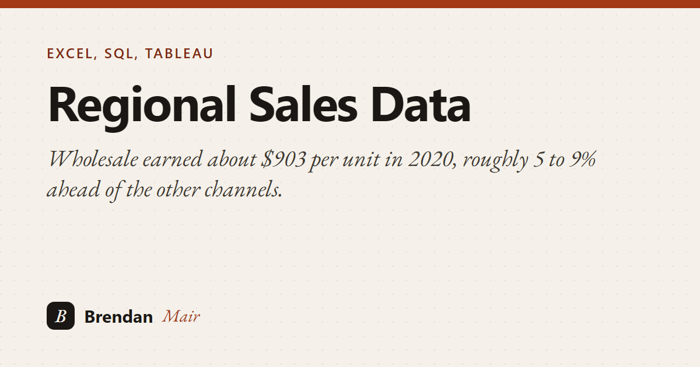

# Regional Sales: which channel really earns the most per sale

Revenue shows which sales channels sell the most, not which ones earn the most once costs are counted. This analysis builds profit from price and cost first, then compares four channels (In-Store, Online, Distributor and Wholesale) across sales teams, regions and warehouses.

**Result:** Wholesale led on average unit profit in 2020, about $903, roughly 5 to 9% ahead of the other three channels.

[Case study](https://brendanmair.pages.dev/projects/regional-sales/) · [Dashboards (Tableau Public)](https://public.tableau.com/app/profile/brendan.mair/vizzes) · [Presentation](https://gamma.app/docs/Exploring-Regional-Sales-Profitability-of-Different-Sales-Channel-gxo9ply9p9ghytj)

## What the SQL answers

[`regional_sales.sql`](regional_sales.sql) joins the sales, order, product and customer tables to answer the questions a sales lead would ask:

1. Which sales channel and warehouse earn the most and least unit profit?
2. Which sales team sells most in which state and region, and which region is most profitable?
3. Which channel has the most orders and the highest order quantity?
4. Which product sells most, and which team sells it?
5. How many orders are very, somewhat or not very profitable?
6. How long is the gap between order date and ship date?
7. Which store gives the most discount, and through which team?
8. Which customer segment orders most, and which ship mode each region prefers?

Techniques: joins, aggregation, window functions (`ROW_NUMBER`, `OVER (PARTITION BY ...)`) to pick the top team per region.

## How it fits together

| Step | Tool |
|---|---|
| Clean and standardize dates, build Unit Profit, Net Profit and a three-tier profitability label | Excel |
| Query and aggregate by channel, team, region and warehouse | SQL |
| Dashboards for channel profit by year, team quantity over time, and shipments across six warehouses | Tableau |

The data is a public dataset of sales records. Figures are read from the dashboard, so each is approximate.
